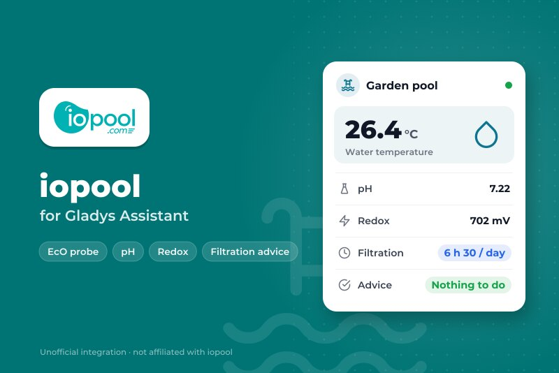
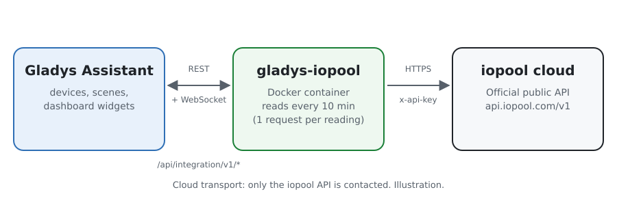
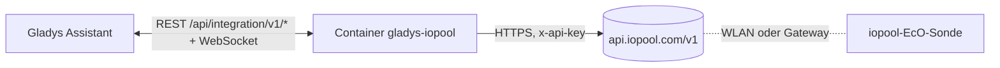
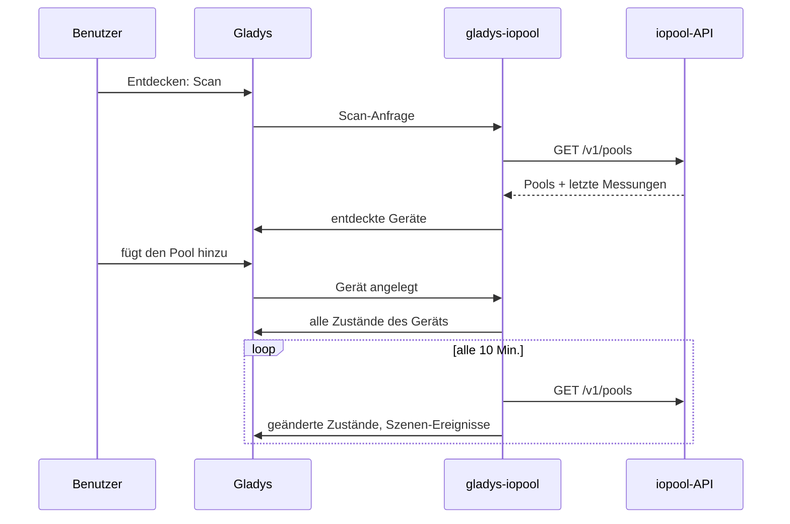
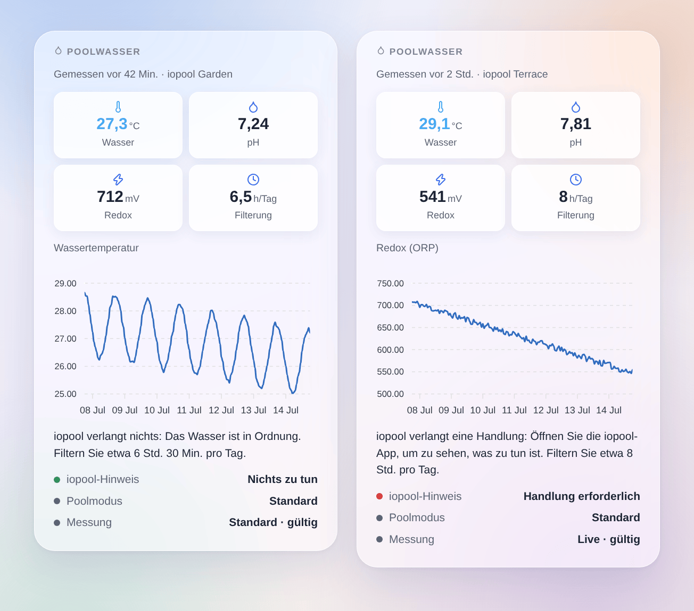

# Gladys iopool

[English](README.md) · [Français](README.fr.md) · **Deutsch** · [Español](README.es.md)

[](LICENSE)
[](https://github.com/William-De71/gladys-iopool/releases)
[](https://github.com/William-De71/gladys-iopool/actions/workflows/release.yml)
[](https://gladysassistant.com)



Eine externe Integration für [Gladys Assistant](https://gladysassistant.com), die die Pools eines iopool-Kontos (iopool-EcO-Sonde) über die offizielle öffentliche iopool-API in Gladys bringt. Wassertemperatur, pH-Wert, Redox, empfohlene Filterung und die Hinweise von iopool werden zu Geräten, Szenen-Auslösern und einem Dashboard-Widget.

## Funktionen

- Ein **Gerät pro Pool**: Wassertemperatur, pH-Wert, Redox (ORP), empfohlene tägliche Filterung, von iopool verlangte Handlung, Poolmodus.
- **5 Szenen-Auslöser**: neue Messung, Handlung erforderlich oder erledigt, Poolmodus geändert, Filterempfehlung geändert, seit 24 Stunden keine Messung.
- **1 Szenen-Aktion**: einen Pool lesen, für eine Nachricht oder eine Bedingung.
- **1 Dashboard-Widget**: das Poolwasser auf einen Blick, mit dem Verlauf eines Werts und dem, was iopool verlangt.
- Nur lesend, offizielle API, eine Anfrage pro Lesen für das ganze Konto.
- Englisch, Französisch, Deutsch und Spanisch überall.

## Funktionsweise





iopool hat keine lokale API: Die EcO-Sonde sendet ihre Messungen an die iopool-Cloud (etwa einmal pro Stunde). Die Integration liest `GET /v1/pools` der [öffentlichen iopool-API](https://help.iopool.com/en/articles/5537423-iopool-public-api) mit dem API-Schlüssel des Kontos, standardmäßig alle 10 Minuten: Eine Anfrage liefert alle Pools mit ihrer letzten Messung, ihrem Modus, der Filterempfehlung und einer etwa erforderlichen Handlung. Das erste Lesen nach einem Start dient als Referenz: Übergänge werden ab dem nächsten gemeldet.



Die API ist nur lesend: Aus Gladys wird nichts gesteuert, es gibt keinen Befehlsschritt.

### Transport

Nur **Cloud** (`"transports": ["cloud"]`): Gladys zeigt im Katalog das Cloud-Abzeichen. Die Integration spricht nur mit `api.iopool.com`. Ihr API-Schlüssel verlässt Ihr Netz zur iopool-API, nur lesend; keine Daten gehen anderswohin.

## Geräte und Funktionen

| Gerät               | Funktion              | Gladys-Kategorie / -Typ             |
| ------------------- | --------------------- | ----------------------------------- |
| iopool `<Poolname>` | Wassertemperatur      | Temperatursensor, °C                |
|                     | pH-Wert               | pH-Sensor                           |
|                     | Redox (ORP)           | ORP-Sensor, mV                      |
|                     | Empfohlene Filterung  | Dauer (ganzzahlig), Minuten pro Tag |
|                     | Handlung erforderlich | Text                                |
|                     | Poolmodus             | Text                                |

Die externen IDs beruhen auf der iopool-ID des Pools, nie auf seinem Namen. iopool sendet die Filterempfehlung in Stunden; das Gerät speichert sie in Minuten, damit „6 Std. 30“ genau bleibt.

## Szenen-Auslöser, -Aktionen und Widget

| Art      | Schlüssel                   | Verwendung                                                              |
| -------- | --------------------------- | ----------------------------------------------------------------------- |
| Auslöser | `new_measure`               | Die Sonde hat eine neue Messung gesendet (alle Werte als Variablen)     |
| Auslöser | `action_required_changed`   | iopool verlangt eine Handlung oder nicht mehr (Filter auf die Änderung) |
| Auslöser | `pool_mode_changed`         | Standard, Saisonstart, aktive oder passive Überwinterung (Filter)       |
| Auslöser | `filtration_advice_changed` | Die empfohlene tägliche Filterung hat sich geändert                     |
| Auslöser | `measures_stopped`          | Seit 24 Stunden keine Messung, außer bei passiver Überwinterung         |
| Aktion   | `get_pool`                  | Letzte Messung und Empfehlungen als Szenen-Ausgaben                     |
| Widget   | `pool`                      | Kacheln, Verlaufsdiagramm, Hinweis, Poolmodus, Messmodus                |

Szenen-Beispiele:

- Wenn iopool eine Handlung verlangt → eine Nachricht mit `{{triggerEvent.data.summary}}` senden.
- Wenn sich die Filterempfehlung ändert → die Pumpensteckdose `{{triggerEvent.data.minutes}}` Minuten pro Tag eingeschaltet lassen.
- Wenn der Pool in die passive Überwinterung geht → die Pool-Szenen ausschalten.
- Jeden Abend um 20 Uhr → den Pool lesen und „Wasser bei {{…temperature}} °C“ senden.



## Voraussetzungen

- Gladys Assistant **5.3.0** oder neuer (Katalog-Schlüsselwörter von Gladys 5.3, Widgets und Szenen externer Integrationen). Ältere Instanzen können sie nicht installieren.
- Eine iopool-EcO-Sonde, die bereits in der iopool-App funktioniert, und der API-Schlüssel des Kontos (iopool-App → Einstellungen, ganz unten).

## Installation

- **Aus dem Store**: Integrationen → „iopool“ suchen → Installieren.
- **Über die URL des Repositorys**: Integrationen → Integration installieren → `https://github.com/William-De71/gladys-iopool`.
- **Entwicklermodus**: Integrationen → Integration installieren → Entwicklermodus, mit dem Image `ghcr.io/william-de71/gladys-iopool:<version>`.

## Konfiguration

| Feld                 | Pflicht | Beschreibung                                                           |
| -------------------- | ------- | ---------------------------------------------------------------------- |
| API-Schlüssel        | Ja      | Als Geheimnis gespeichert, nie in den Logs                             |
| Leseintervall (Min.) | Nein    | 5 bis 60, standardmäßig 10 (die Sonde misst etwa einmal pro Stunde)    |
| Sprache der Texte    | Nein    | Funktionsnamen, Poolmodi, Zusammenfassungen; standardmäßig automatisch |

**API-Schlüssel testen** liest die API und zählt die Pools des Kontos.

## Verwendung

1. Fügen Sie den API-Schlüssel der iopool-App ein und speichern Sie.
2. Geräte → iopool → Entdecken: Fügen Sie den Pool hinzu.
3. Szenen: Wählen Sie einen iopool-Auslöser, filtern Sie auf ein Gerät, nutzen Sie die Variablen in einer Nachricht.
4. Dashboard: Fügen Sie das Widget „Poolwasser“ hinzu und wählen Sie das Diagramm.

Die Benutzerdokumentation steht in [docs/de.md](docs/de.md) ([en](docs/en.md), [fr](docs/fr.md), [es](docs/es.md)).

## Entwicklung

```bash
npm install
npm test                       # node --test, ohne Netzwerkzugriff
npm run lint                   # ESLint
npm run format:check           # Prettier
npx github:GladysAssistant/integration-store . --skip-image-check
scripts/build-cover.sh         # cover.jpg aus docs/assets/cover.svg
docs/illustrations/render.sh   # docs/assets/widgets.<lang>.png
```

Lokal liest das SDK `GLADYS_HOST_API_URL`, `GLADYS_INTEGRATION_TOKEN` und `GLADYS_INTEGRATION_SELECTOR` (von Gladys im Entwicklermodus geliefert). `DEBUG=gladys-integration-sdk` zeigt die Logs des SDK.

Die Tests decken den iopool-Client, das Lesen der Antworten, die Übergänge, die Geräte (die Felder, die der Bildschirm Entdecken verlangt), das Widget (`validateWidgetContent`), die Szenen-Ereignisse und -Ausgaben, das Manifest, die vier Sprachen, das Release-Skript und die ganze Integration gegen das falsche Gladys des SDK und eine falsche iopool-API ab. `test/structure.test.js` friert jeden Schlüssel ein, den Benutzer speichern.

## Release-Prozess


Jeder Merge auf `main` startet die CI und berechnet dann die Version aus den [Conventional Commits](https://www.conventionalcommits.org/) seit dem letzten Tag: `feat` → Minor, `fix` / `perf` → Patch, `!` oder `BREAKING CHANGE` → Major (Minor unter 1.0.0); `docs`, `chore`, `ci`, `test`, `style`, `refactor`, `build` allein veröffentlichen nichts. Der Changelog-Abschnitt wird erzeugt, der Tag gepusht, das Multi-Architektur-Image gebaut, dann erhält `main` den Release-Commit, das GitHub-Release wird erstellt und ein letzter Job prüft das öffentliche Image, den Store-Validator und das Topic.

- Der Titel des Pull Requests wird zum Squash-Commit und dann zur Changelog-Zeile: Schreiben Sie ihn auf Englisch, für den Benutzer (`pr-title.yml` prüft ihn). Bearbeiten Sie `CHANGELOG.md` nie von Hand.
- 1.0.0 ist eine Entscheidung: Actions → Release → Run workflow mit `release-as: 1.0.0`. `dry-run` zeigt Version und Notizen, ohne zu veröffentlichen.
- **Geschützter Branch**: Das Release pusht seinen Commit mit `GITHUB_TOKEN` auf `main`. Mit einem Ruleset auf `main`, das strenger ist als „kein Löschen, kein Force-Push“, fügen Sie GitHub Actions zur Ausnahmeliste hinzu (oder pushen Sie über eine GitHub App), sonst schlägt der Veröffentlichungs-Job mit Anweisungen fehl.
- Machen Sie nach dem ersten Release das `ghcr.io`-Paket öffentlich (Package settings → Change visibility), sonst kann Gladys es nicht laden.

## Fehlerbehebung

Siehe [docs/de.md](docs/de.md#fehlerbehebung). Melden Sie Probleme mit den Versionen von Gladys und der Integration und den Logs (`DEBUG=gladys-integration-sdk`).

## Mitwirken

Issues und Pull Requests sind willkommen. Führen Sie vor einem Pull Request `npm run format:check && npm run lint && npm test` aus und lassen Sie alle externen IDs und gespeicherten Schlüssel unverändert (siehe [CLAUDE.md](CLAUDE.md)).

## Sicherheit

Siehe [SECURITY.md](SECURITY.md): Melden Sie Schwachstellen vertraulich. Der API-Schlüssel ist ein `secret`-Feld und steht nie in den Logs.

## Kommende Screenshots

Die Bilder oben sind Illustrationen, keine Screenshots. Echte Screenshots kommen nach `docs/assets/screenshots/` (PNG, 1280 × 800): `configuration.png`, `discovery.png`, `device.png`, `scene.png`.

## Lizenz

[Apache-Lizenz 2.0](LICENSE) — siehe auch [NOTICE](NOTICE). iopool ist eine Marke ihres Inhabers; diese Community-Integration ist nicht mit iopool verbunden. Sie nutzt die [öffentliche iopool-API](https://help.iopool.com/en/articles/5537423-iopool-public-api). Dank an die Dokumentation und das SDK von Gladys.
