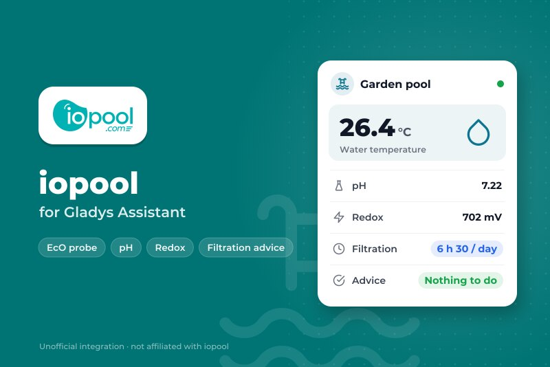
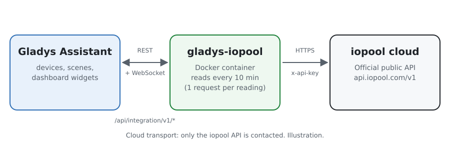
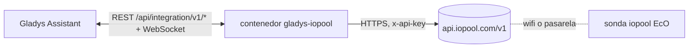
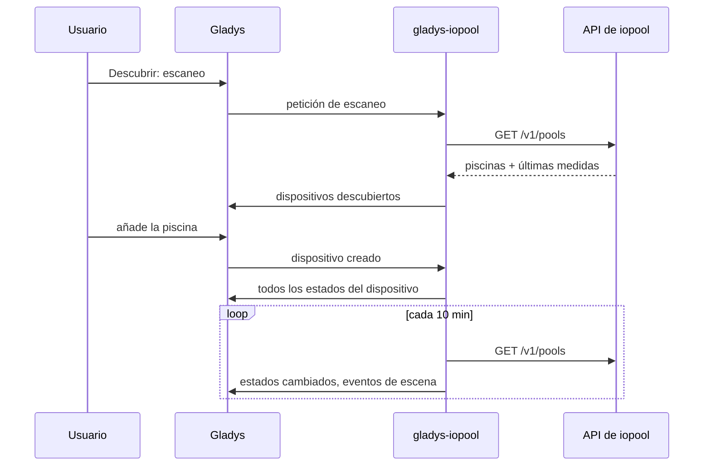
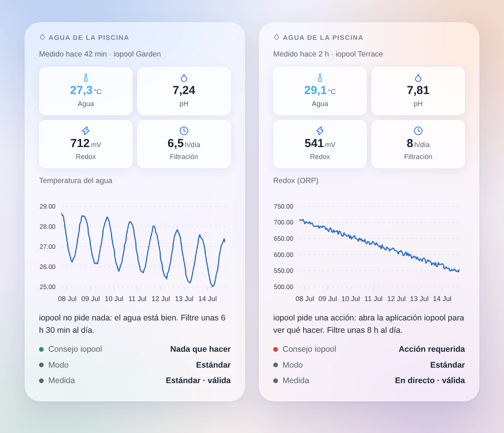

# Gladys iopool

[English](README.md) · [Français](README.fr.md) · [Deutsch](README.de.md) · **Español**

[](LICENSE)
[](https://github.com/William-De71/gladys-iopool/releases)
[](https://github.com/William-De71/gladys-iopool/actions/workflows/release.yml)
[](https://gladysassistant.com)



Una integración externa para [Gladys Assistant](https://gladysassistant.com) que trae a Gladys las piscinas de una cuenta iopool (sonda iopool EcO), mediante la API pública oficial de iopool. La temperatura del agua, el pH, el redox, la filtración recomendada y lo que pide iopool se convierten en dispositivos, disparadores de escena y un widget de panel.

## Funcionalidades

- Un **dispositivo por piscina**: temperatura del agua, pH, redox (ORP), filtración diaria recomendada, acción pedida por iopool, modo de la piscina.
- **5 disparadores de escena**: nueva medida, acción requerida o resuelta, modo de la piscina cambiado, consejo de filtración cambiado, ninguna medida desde hace 24 horas.
- **1 acción de escena**: leer una piscina, para un mensaje o una condición.
- **1 widget de panel**: el agua de la piscina de un vistazo, con el historial de un valor y lo que pide iopool.
- Solo lectura, API oficial, una petición por lectura para toda la cuenta.
- Inglés, francés, alemán y español en todas partes.

## Funcionamiento





iopool no tiene API local: la sonda EcO envía sus medidas a la nube de iopool (aproximadamente una vez por hora). La integración lee `GET /v1/pools` de la [API pública de iopool](https://help.iopool.com/en/articles/5537423-iopool-public-api) con la clave API de la cuenta, cada 10 minutos por defecto: una petición devuelve todas las piscinas con su última medida, su modo, el consejo de filtración y si se requiere una acción. La primera lectura tras un arranque sirve de referencia: las transiciones se señalan a partir de la siguiente.



La API es de solo lectura: nada se controla desde Gladys, no hay paso de comando.

### Transporte

Solo **nube** (`"transports": ["cloud"]`): Gladys muestra la insignia Nube en el catálogo. La integración solo habla con `api.iopool.com`. Su clave API sale de su red hacia la API de iopool, en solo lectura; ningún dato va a otro sitio.

## Dispositivos y funciones

| Dispositivo       | Función                | Categoría / tipo Gladys           |
| ----------------- | ---------------------- | --------------------------------- |
| iopool `<nombre>` | Temperatura del agua   | Sensor de temperatura, °C         |
|                   | pH                     | Sensor de pH                      |
|                   | Redox (ORP)            | Sensor ORP, mV                    |
|                   | Filtración recomendada | Duración (entero), minutos al día |
|                   | Acción requerida       | Texto                             |
|                   | Modo de la piscina     | Texto                             |

Los identificadores externos se basan en el identificador iopool de la piscina, nunca en su nombre. iopool envía el consejo de filtración en horas; el dispositivo lo guarda en minutos para que «6 h 30 min» siga siendo exacto.

## Disparadores, acciones de escena y widget

| Tipo       | Clave                       | Uso                                                                     |
| ---------- | --------------------------- | ----------------------------------------------------------------------- |
| Disparador | `new_measure`               | La sonda envió una nueva medida (todos los valores como variables)      |
| Disparador | `action_required_changed`   | iopool empieza o deja de pedir una acción (filtro sobre el cambio)      |
| Disparador | `pool_mode_changed`         | Estándar, puesta en marcha, invernaje activo o pasivo (filtro por modo) |
| Disparador | `filtration_advice_changed` | La filtración diaria recomendada cambió                                 |
| Disparador | `measures_stopped`          | Ninguna medida desde hace 24 horas, salvo en invernaje pasivo           |
| Acción     | `get_pool`                  | La última medida y los consejos como salidas de escena                  |
| Widget     | `pool`                      | Casillas, gráfico de historial, consejo, modo de piscina y de medida    |

Ejemplos de escenas:

- Cuando iopool pide una acción → enviar un mensaje con `{{triggerEvent.data.summary}}`.
- Cuando cambia el consejo de filtración → dejar encendido el enchufe de la bomba `{{triggerEvent.data.minutes}}` minutos al día.
- Cuando la piscina pasa a invernaje pasivo → desactivar las escenas de la piscina.
- Cada tarde a las 20:00 → leer la piscina y enviar «agua a {{…temperature}} °C».



## Requisitos

- Gladys Assistant **5.3.0** o posterior (palabras clave del catálogo de Gladys 5.3, widgets y escenas de las integraciones externas). Las instancias más antiguas no pueden instalarla.
- Una sonda iopool EcO que ya funcione en la aplicación iopool, y la clave API de la cuenta (aplicación iopool → Ajustes, abajo del todo).

## Instalación

- **Desde la tienda**: Integraciones → buscar «iopool» → Instalar.
- **Desde la URL del repositorio**: Integraciones → Instalar una integración → `https://github.com/William-De71/gladys-iopool`.
- **Modo desarrollador**: Integraciones → Instalar una integración → Modo desarrollador, con la imagen `ghcr.io/william-de71/gladys-iopool:<version>`.

## Configuración

| Campo                      | Obligatorio | Descripción                                                            |
| -------------------------- | ----------- | ---------------------------------------------------------------------- |
| Clave API                  | Sí          | Guardada como secreto, nunca en los logs                               |
| Intervalo de lectura (min) | No          | De 5 a 60, 10 por defecto (la sonda mide una vez por hora más o menos) |
| Idioma de los textos       | No          | Nombres de funciones, modos, resúmenes; automático por defecto         |

**Probar la clave API** lee la API y cuenta las piscinas de la cuenta.

## Uso

1. Pegue la clave API de la aplicación iopool y guarde.
2. Dispositivos → iopool → Descubrir: añada la piscina.
3. Escenas: elija un disparador iopool, filtre por un dispositivo, use las variables en un mensaje.
4. Panel: añada el widget «Agua de la piscina» y elija el gráfico.

La documentación de usuario está en [docs/es.md](docs/es.md) ([en](docs/en.md), [fr](docs/fr.md), [de](docs/de.md)).

## Desarrollo

```bash
npm install
npm test                       # node --test, sin tocar nunca la red
npm run lint                   # ESLint
npm run format:check           # Prettier
npx github:GladysAssistant/integration-store . --skip-image-check
scripts/build-cover.sh         # cover.jpg a partir de docs/assets/cover.svg
docs/illustrations/render.sh   # docs/assets/widgets.<lang>.png
```

En local, el SDK lee `GLADYS_HOST_API_URL`, `GLADYS_INTEGRATION_TOKEN` y `GLADYS_INTEGRATION_SELECTOR` (que Gladys da en modo desarrollador). `DEBUG=gladys-integration-sdk` muestra los logs del SDK.

Las pruebas cubren el cliente iopool, la lectura de las respuestas, las transiciones, los dispositivos (los campos que exige la pantalla Descubrir), el widget (`validateWidgetContent`), los eventos y salidas de escena, el manifiesto, los cuatro idiomas, el script de release, y toda la integración frente al Gladys falso del SDK y una API iopool falsa. `test/structure.test.js` congela todas las claves que guardan los usuarios.

## Proceso de release


Cada fusión en `main` lanza la CI y calcula la versión a partir de los [Conventional Commits](https://www.conventionalcommits.org/) desde la última etiqueta: `feat` → menor, `fix` / `perf` → parche, `!` o `BREAKING CHANGE` → mayor (menor por debajo de 1.0.0); `docs`, `chore`, `ci`, `test`, `style`, `refactor`, `build` solos no publican nada. Se genera la sección del changelog, se empuja la etiqueta, se construye la imagen multiarquitectura, luego `main` recibe el commit de release, se crea la GitHub Release y un último job comprueba la imagen pública, el validador de la tienda y el topic.

- El título del pull request se convierte en el commit squash y luego en la línea del changelog: escríbalo en inglés, para el usuario (`pr-title.yml` lo comprueba). No edite nunca `CHANGELOG.md` a mano.
- La 1.0.0 es una decisión: Actions → Release → Run workflow con `release-as: 1.0.0`. `dry-run` muestra la versión y las notas sin publicar.
- **Rama protegida**: la release empuja su commit a `main` con `GITHUB_TOKEN`. Con un ruleset en `main` más estricto que «ni borrado ni force push», añada GitHub Actions a su lista de excepciones (o empuje mediante una GitHub App); si no, el job de publicación falla con instrucciones.
- Tras la primera release, haga público el paquete `ghcr.io` (Package settings → Change visibility), o Gladys no podrá descargarlo.

## Solución de problemas

Vea [docs/es.md](docs/es.md#solución-de-problemas). Informe de los problemas con las versiones de Gladys y de la integración y los logs (`DEBUG=gladys-integration-sdk`).

## Contribuir

Issues y pull requests son bienvenidos. Ejecute `npm run format:check && npm run lint && npm test` antes de abrir un pull request y mantenga sin cambios todos los identificadores externos y claves guardadas (vea [CLAUDE.md](CLAUDE.md)).

## Seguridad

Vea [SECURITY.md](SECURITY.md): informe de las vulnerabilidades en privado. La clave API es un campo `secret`, nunca en los logs.

## Capturas por venir

Las imágenes de arriba son ilustraciones, no capturas de pantalla. Las capturas reales irán en `docs/assets/screenshots/` (PNG, 1280 × 800): `configuration.png`, `discovery.png`, `device.png`, `scene.png`.

## Licencia

[Licencia Apache 2.0](LICENSE) — vea también [NOTICE](NOTICE). iopool es una marca de su propietario; esta integración comunitaria no está afiliada a iopool. Se basa en la [API pública de iopool](https://help.iopool.com/en/articles/5537423-iopool-public-api). Gracias a la documentación y al SDK de Gladys.
