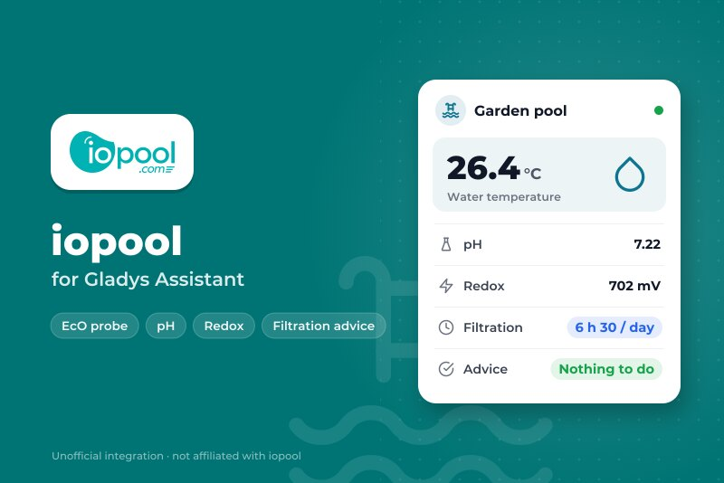
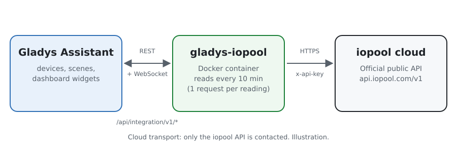
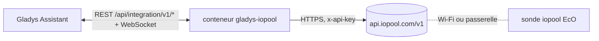
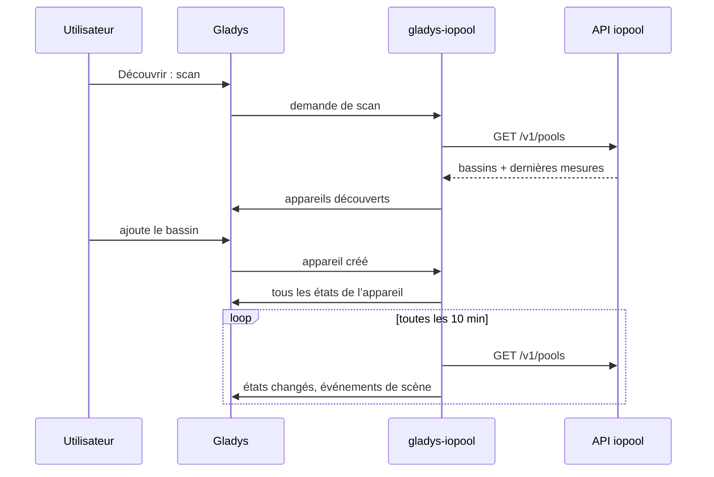
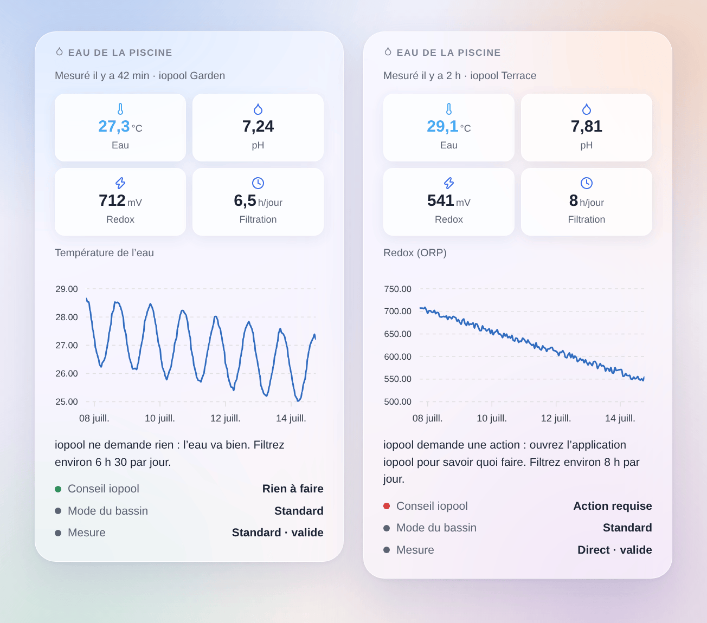

# Gladys iopool

[English](README.md) · **Français** · [Deutsch](README.de.md) · [Español](README.es.md)

[](LICENSE)
[](https://github.com/William-De71/gladys-iopool/releases)
[](https://github.com/William-De71/gladys-iopool/actions/workflows/release.yml)
[](https://gladysassistant.com)



Une intégration externe pour [Gladys Assistant](https://gladysassistant.com) qui amène dans Gladys les bassins d’un compte iopool (sonde iopool EcO), par l’API publique officielle d’iopool. Température de l’eau, pH, redox, filtration recommandée et demandes d’iopool deviennent des appareils, des déclencheurs de scène et un widget de tableau de bord.

## Fonctionnalités

- Un **appareil par bassin** : température de l’eau, pH, redox (ORP), filtration quotidienne recommandée, action demandée par iopool, mode du bassin.
- **5 déclencheurs de scène** : nouvelle mesure, action requise ou résolue, mode du bassin changé, conseil de filtration changé, aucune mesure depuis 24 heures.
- **1 action de scène** : lire un bassin, pour un message ou une condition.
- **1 widget de tableau de bord** : l’eau du bassin d’un coup d’œil, avec l’historique d’une valeur et ce que demande iopool.
- Lecture seule, API officielle, une requête par lecture pour tout le compte.
- Anglais, français, allemand et espagnol partout.

## Fonctionnement





iopool n’a pas d’API locale : la sonde EcO envoie ses mesures au cloud iopool (environ une fois par heure). L’intégration lit `GET /v1/pools` de l’[API publique iopool](https://help.iopool.com/en/articles/5537423-iopool-public-api) avec la clé API du compte, toutes les 10 minutes par défaut : une requête renvoie tous les bassins avec leur dernière mesure, leur mode, le conseil de filtration et l’éventuelle action requise. La première lecture après un démarrage sert de référence : les transitions sont signalées à partir de la suivante.



L’API est en lecture seule : rien ne se pilote depuis Gladys, il n’y a pas d’étape de commande.

### Transport

**Cloud** uniquement (`"transports": ["cloud"]`) : Gladys affiche le badge Cloud dans le catalogue. L’intégration ne parle qu’à `api.iopool.com`. Votre clé API quitte votre réseau pour l’API iopool, en lecture seule ; aucune donnée ne part ailleurs.

## Appareils et fonctionnalités

| Appareil       | Fonctionnalité         | Catégorie / type Gladys          |
| -------------- | ---------------------- | -------------------------------- |
| iopool `<nom>` | Température de l’eau   | Capteur de température, °C       |
|                | pH                     | Capteur de pH                    |
|                | Redox (ORP)            | Capteur ORP, mV                  |
|                | Filtration recommandée | Durée (entier), minutes par jour |
|                | Action requise         | Texte                            |
|                | Mode du bassin         | Texte                            |

Les identifiants externes reposent sur l’identifiant iopool du bassin, jamais sur son nom. iopool envoie le conseil de filtration en heures ; l’appareil le garde en minutes pour que « 6 h 30 » reste exact.

## Déclencheurs, actions de scène et widget

| Type        | Clé                         | Usage                                                                     |
| ----------- | --------------------------- | ------------------------------------------------------------------------- |
| Déclencheur | `new_measure`               | La sonde a envoyé une nouvelle mesure (toutes les valeurs en variables)   |
| Déclencheur | `action_required_changed`   | iopool se met à demander une action ou cesse (filtre sur le changement)   |
| Déclencheur | `pool_mode_changed`         | Standard, remise en route, hivernage actif ou passif (filtre sur le mode) |
| Déclencheur | `filtration_advice_changed` | La filtration quotidienne recommandée a changé                            |
| Déclencheur | `measures_stopped`          | Aucune mesure depuis 24 heures, hors hivernage passif                     |
| Action      | `get_pool`                  | La dernière mesure et les conseils en sorties de scène                    |
| Widget      | `pool`                      | Tuiles, graphique d’historique, conseil, mode du bassin, mode de mesure   |

Exemples de scènes :

- Quand iopool demande une action → envoyer un message avec `{{triggerEvent.data.summary}}`.
- Quand le conseil de filtration change → laisser la prise de la pompe allumée `{{triggerEvent.data.minutes}}` minutes par jour.
- Quand le bassin passe en hivernage passif → désactiver les scènes de la piscine.
- Chaque soir à 20 h → lire le bassin et envoyer « eau à {{…temperature}} °C ».



## Prérequis

- Gladys Assistant **5.3.0** ou plus récent (mots-clés du catalogue de Gladys 5.3, widgets et scènes des intégrations externes). Les instances plus anciennes ne peuvent pas l’installer.
- Une sonde iopool EcO qui fonctionne déjà dans l’application iopool, et la clé API du compte (application iopool → Paramètres, tout en bas).

## Installation

- **Depuis le store** : Intégrations → rechercher « iopool » → Installer.
- **Depuis l’URL du dépôt** : Intégrations → Installer une intégration → `https://github.com/William-De71/gladys-iopool`.
- **Mode développeur** : Intégrations → Installer une intégration → Mode développeur, avec l’image `ghcr.io/william-de71/gladys-iopool:<version>`.

## Configuration

| Champ                       | Obligatoire | Description                                                                 |
| --------------------------- | ----------- | --------------------------------------------------------------------------- |
| Clé API                     | Oui         | Enregistrée comme secret, jamais dans les logs                              |
| Intervalle de lecture (min) | Non         | De 5 à 60, 10 par défaut (la sonde mesure environ une fois par heure)       |
| Langue des textes           | Non         | Noms des fonctionnalités, modes du bassin, résumés ; automatique par défaut |

**Tester la clé API** lit l’API et compte les bassins du compte.

## Utilisation

1. Collez la clé API de l’application iopool, puis enregistrez.
2. Appareils → iopool → Découvrir : ajoutez le bassin.
3. Scènes : choisissez un déclencheur iopool, filtrez sur un appareil, utilisez les variables dans un message.
4. Tableau de bord : ajoutez le widget « Eau de la piscine », choisissez le graphique.

La documentation utilisateur est dans [docs/fr.md](docs/fr.md) ([en](docs/en.md), [de](docs/de.md), [es](docs/es.md)).

## Développement

```bash
npm install
npm test                       # node --test, sans jamais toucher le réseau
npm run lint                   # ESLint
npm run format:check           # Prettier
npx github:GladysAssistant/integration-store . --skip-image-check
scripts/build-cover.sh         # cover.jpg depuis docs/assets/cover.svg
docs/illustrations/render.sh   # docs/assets/widgets.<lang>.png
```

En local, le SDK lit `GLADYS_HOST_API_URL`, `GLADYS_INTEGRATION_TOKEN` et `GLADYS_INTEGRATION_SELECTOR` (fournis par Gladys en mode développeur). `DEBUG=gladys-integration-sdk` affiche les logs du SDK.

Les tests couvrent le client iopool, la lecture des réponses, les transitions, les appareils (les champs qu’exige l’écran Découvrir), le widget (`validateWidgetContent`), les événements et sorties de scène, le manifeste, les quatre langues, le script de release, et toute l’intégration face au faux Gladys du SDK et à une fausse API iopool. `test/structure.test.js` fige toutes les clés que les utilisateurs enregistrent.

## Processus de release


Chaque fusion sur `main` lance la CI, puis calcule la version d’après les [Conventional Commits](https://www.conventionalcommits.org/) depuis le dernier tag : `feat` → mineure, `fix` / `perf` → correctif, `!` ou `BREAKING CHANGE` → majeure (mineure sous 1.0.0) ; `docs`, `chore`, `ci`, `test`, `style`, `refactor`, `build` seuls ne publient rien. La section du changelog est générée, le tag poussé, l’image multi-architecture construite, puis `main` reçoit le commit de release, la GitHub Release est créée et un dernier job vérifie l’image publique, le validateur du store et le topic.

- Le titre de la pull request devient le commit squash, puis la ligne du changelog : écrivez-le en anglais, pour l’utilisateur (`pr-title.yml` le vérifie). Ne modifiez jamais `CHANGELOG.md` à la main.
- La 1.0.0 est une décision : Actions → Release → Run workflow avec `release-as: 1.0.0`. `dry-run` affiche la version et les notes sans rien publier.
- **Branche protégée** : la release pousse son commit sur `main` avec `GITHUB_TOKEN`. Avec un ruleset sur `main` plus strict que « ni suppression ni force-push », ajoutez GitHub Actions à sa liste de contournement (ou poussez par une GitHub App), sinon le job de publication échoue avec des instructions.
- Après la première release, rendez public le package `ghcr.io` (Package settings → Change visibility), sinon Gladys ne peut pas le télécharger.

## Dépannage

Voir [docs/fr.md](docs/fr.md#dépannage). Signalez les problèmes avec les versions de Gladys et de l’intégration et les logs (`DEBUG=gladys-integration-sdk`).

## Contribuer

Issues et pull requests bienvenues. Lancez `npm run format:check && npm run lint && npm test` avant d’ouvrir une pull request, et gardez inchangés tous les identifiants externes et clés enregistrées (voir [CLAUDE.md](CLAUDE.md)).

## Sécurité

Voir [SECURITY.md](SECURITY.md) : signalez les failles en privé. La clé API est un champ `secret`, jamais dans les logs.

## Captures à venir

Les images ci-dessus sont des illustrations, pas des captures d’écran. Les vraies captures iront dans `docs/assets/screenshots/` (PNG, 1280 × 800) : `configuration.png`, `discovery.png`, `device.png`, `scene.png`.

## Licence

[Licence Apache 2.0](LICENSE) — voir aussi [NOTICE](NOTICE). iopool est une marque de son propriétaire ; cette intégration communautaire n’est pas affiliée à iopool. Elle s’appuie sur l’[API publique iopool](https://help.iopool.com/en/articles/5537423-iopool-public-api). Merci à la documentation et au SDK de Gladys.
