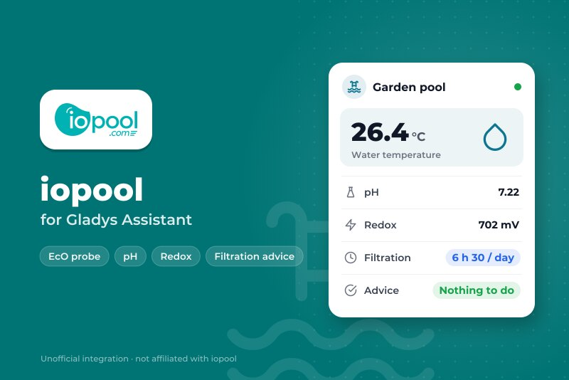
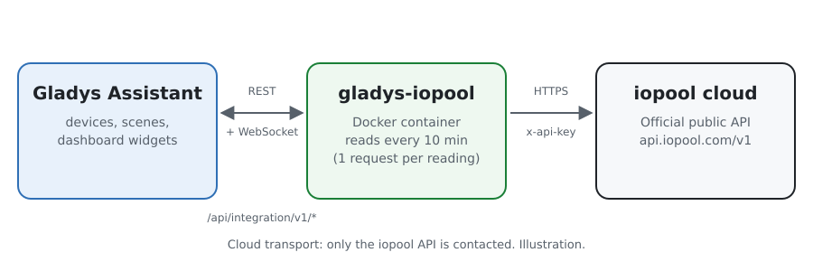
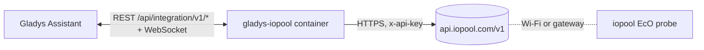
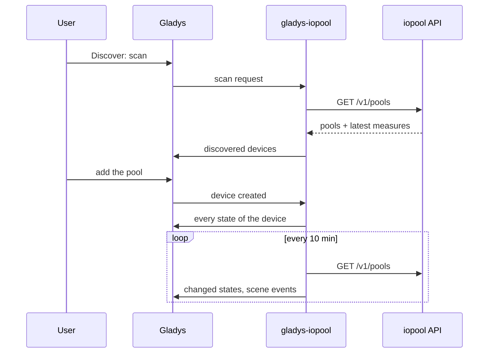
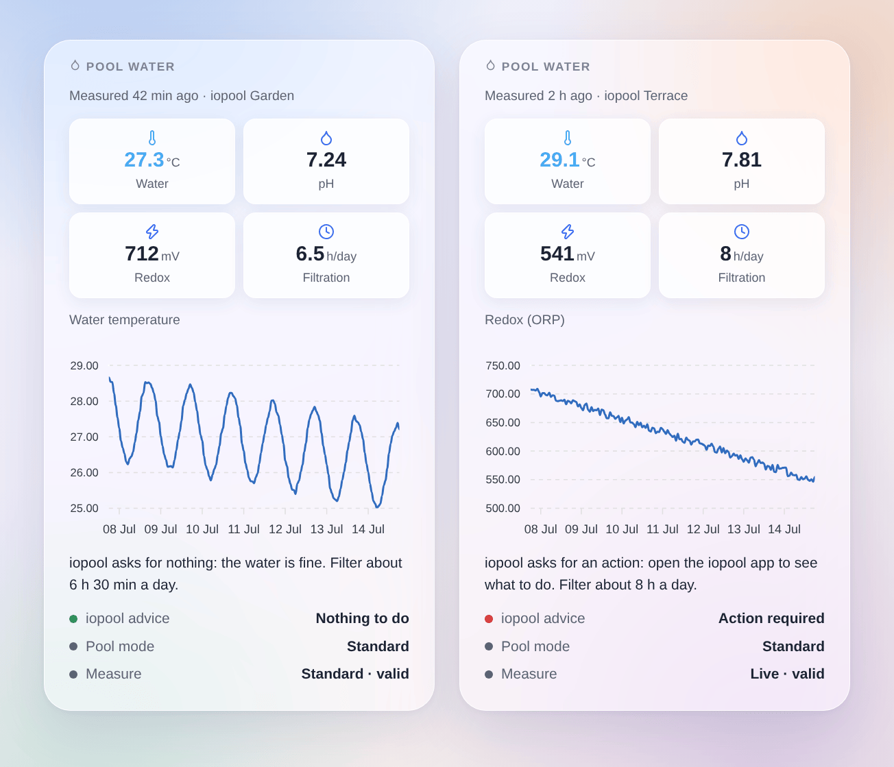

# Gladys iopool

**English** · [Français](README.fr.md) · [Deutsch](README.de.md) · [Español](README.es.md)

[](LICENSE)
[](https://github.com/William-De71/gladys-iopool/releases)
[](https://github.com/William-De71/gladys-iopool/actions/workflows/release.yml)
[](https://gladysassistant.com)



An external integration for [Gladys Assistant](https://gladysassistant.com) that brings the pools of an iopool account (iopool EcO probe) into Gladys, through the official iopool public API. Water temperature, pH, redox, the recommended filtration and what iopool asks become devices, scene triggers and a dashboard widget.

## Features

- A **device per pool**: water temperature, pH, redox (ORP), recommended daily filtration, action required by iopool, pool mode.
- **5 scene triggers**: new measure, action required or resolved, pool mode changed, filtration advice changed, no measure for 24 hours.
- **1 scene action**: read a pool, for a message or a condition.
- **1 dashboard widget**: the pool water at a glance, with the history of one value and what iopool asks.
- Read-only, official API, one request per reading for the whole account.
- English, French, German and Spanish everywhere.

## How it works





iopool has no local API: the EcO probe sends its measures to the iopool cloud (about once an hour). The integration reads `GET /v1/pools` of the [iopool public API](https://help.iopool.com/en/articles/5537423-iopool-public-api) with the API key of the account, every 10 minutes by default: one request returns every pool with its latest measure, its mode, the filtration advice and whether an action is required. The first reading after a start is a reference: transitions are reported from the next one on.



The API is read-only: nothing is controlled from Gladys, there is no `set value` step.

### Transport

**Cloud** only (`"transports": ["cloud"]`): Gladys shows the Cloud badge in the catalog. The integration talks to `api.iopool.com` and nothing else. Your API key leaves your network for the iopool API, read-only; no data goes anywhere else.

## Devices and features

| Device               | Feature                | Gladys category / type            |
| -------------------- | ---------------------- | --------------------------------- |
| iopool `<pool name>` | Water temperature      | Temperature sensor, °C            |
|                      | pH                     | pH sensor                         |
|                      | Redox (ORP)            | ORP sensor, mV                    |
|                      | Recommended filtration | Duration (integer), minutes a day |
|                      | Action required        | Text                              |
|                      | Pool mode              | Text                              |

External ids rely on the pool id of iopool, never on its name. iopool sends the filtration advice in hours; the device keeps it in minutes so that "6 h 30" stays exact.

## Scene triggers, actions and widget

| Kind    | Key                         | Use                                                                 |
| ------- | --------------------------- | ------------------------------------------------------------------- |
| Trigger | `new_measure`               | The probe sent a new measure (all values as variables)              |
| Trigger | `action_required_changed`   | iopool starts or stops asking for an action (filter on the change)  |
| Trigger | `pool_mode_changed`         | Standard, opening, active or passive wintering (filter on the mode) |
| Trigger | `filtration_advice_changed` | The recommended daily filtration changed                            |
| Trigger | `measures_stopped`          | No measure for 24 hours, outside passive wintering                  |
| Action  | `get_pool`                  | The latest measure and the advice as scene outputs                  |
| Widget  | `pool`                      | Tiles, history chart, advice, pool mode, measure mode               |

Scene examples:

- When iopool asks for an action → send a message with `{{triggerEvent.data.summary}}`.
- When the filtration advice changes → keep the pump plug on for `{{triggerEvent.data.minutes}}` minutes a day.
- When the pool moves to passive wintering → switch off the pool scenes.
- Every evening at 8 pm → read the pool and send "water at {{…temperature}} °C".



## Requirements

- Gladys Assistant **5.3.0** or later (catalog keywords of Gladys 5.3, widgets and scenes of external integrations). Older instances cannot install it.
- An iopool EcO probe already working in the iopool app, and the API key of the account (iopool app → Settings, at the bottom).

## Installation

- **From the store**: Integrations → search "iopool" → Install.
- **From the repository URL**: Integrations → Install an integration → `https://github.com/William-De71/gladys-iopool`.
- **Developer mode**: Integrations → Install an integration → Developer mode, with the image `ghcr.io/william-de71/gladys-iopool:<version>`.

## Configuration

| Field                  | Required | Description                                                      |
| ---------------------- | -------- | ---------------------------------------------------------------- |
| API key                | Yes      | Stored as a secret, never logged                                 |
| Reading interval (min) | No       | 5 to 60, 10 by default (the probe measures about once an hour)   |
| Language of the texts  | No       | Feature names, pool modes, scene summaries; automatic by default |

**Test the API key** reads the API and counts the pools of the account.

## Usage

1. Paste the API key of the iopool app, then save.
2. Devices → iopool → Discover: add the pool.
3. Scenes: pick an iopool trigger, filter on a device, use the variables in a message.
4. Dashboard: add the "Pool water" widget, choose the chart.

The user documentation is in [docs/en.md](docs/en.md) ([fr](docs/fr.md), [de](docs/de.md), [es](docs/es.md)).

## Development

```bash
npm install
npm test                       # node --test, never touches the network
npm run lint                   # ESLint
npm run format:check           # Prettier
npx github:GladysAssistant/integration-store . --skip-image-check
scripts/build-cover.sh         # cover.jpg from docs/assets/cover.svg
docs/illustrations/render.sh   # docs/assets/widgets.<lang>.png
```

Locally, the SDK reads `GLADYS_HOST_API_URL`, `GLADYS_INTEGRATION_TOKEN` and `GLADYS_INTEGRATION_SELECTOR` (given by Gladys in developer mode). `DEBUG=gladys-integration-sdk` shows the SDK logs.

The tests cover the iopool client, the reading of the answers, the transitions, the devices (the fields the Discovery screen requires), the widget (`validateWidgetContent`), the scene events and outputs, the manifest, the four languages, the release script, and the whole integration against the fake Gladys of the SDK and a fake iopool API. `test/structure.test.js` freezes every key users store.

## Release process


Every merge on `main` runs the CI, then computes the version from the [Conventional Commits](https://www.conventionalcommits.org/) since the last tag: `feat` → minor, `fix` / `perf` → patch, `!` or `BREAKING CHANGE` → major (a minor below 1.0.0); `docs`, `chore`, `ci`, `test`, `style`, `refactor`, `build` alone publish nothing. The changelog section is generated, the tag pushed, the multi-architecture image built, then `main` receives the release commit, the GitHub Release is created and a last job checks the public image, the store validator and the topic.

- The pull request title becomes the squash commit, then the changelog line: write it in English, for the user (`pr-title.yml` checks it). Never edit `CHANGELOG.md` by hand.
- 1.0.0 is a decision: Actions → Release → Run workflow with `release-as: 1.0.0`. `dry-run` shows the version and the notes without publishing.
- **Protected branch**: the release pushes its commit to `main` with `GITHUB_TOKEN`. With a ruleset on `main` stricter than "no deletion, no force push", add GitHub Actions to its bypass list (or push through a GitHub App), otherwise the publish job fails with instructions.
- After the first release, make the `ghcr.io` package public (Package settings → Change visibility), or Gladys cannot pull it.

## Troubleshooting

See [docs/en.md](docs/en.md#troubleshooting). Report issues with the Gladys and integration versions and the logs (`DEBUG=gladys-integration-sdk`).

## Contributing

Issues and pull requests are welcome. Run `npm run format:check && npm run lint && npm test` before opening a pull request, and keep every external id and stored key unchanged (see [CLAUDE.md](CLAUDE.md)).

## Security

See [SECURITY.md](SECURITY.md): report vulnerabilities privately. The API key is a `secret` field, never logged.

## Screenshots to come

The images above are illustrations, not screenshots. Real screenshots will go in `docs/assets/screenshots/` (PNG, 1280 × 800): `configuration.png`, `discovery.png`, `device.png`, `scene.png`.

## License

[Apache License 2.0](LICENSE) — see also [NOTICE](NOTICE). iopool is a trademark of its owner; this community integration is not affiliated with iopool. It relies on the [iopool public API](https://help.iopool.com/en/articles/5537423-iopool-public-api). Thanks to the Gladys documentation and SDK.
