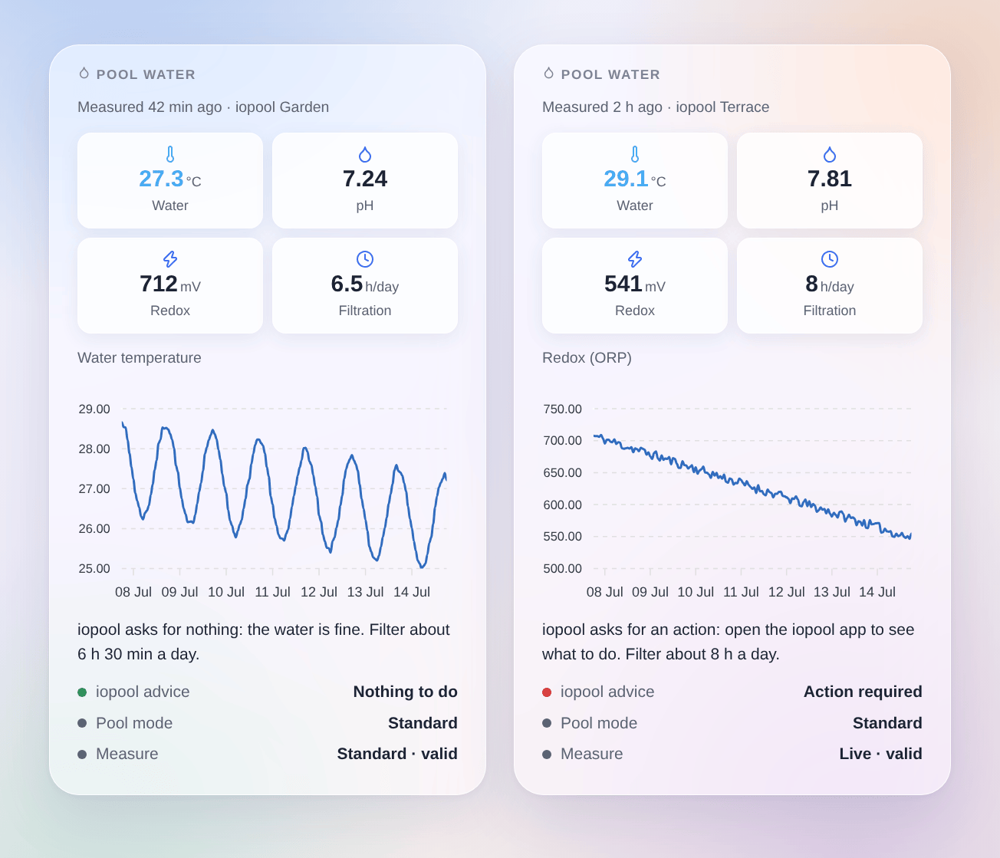

# iopool

## Overview

This integration brings the pools of your **iopool** account (iopool EcO probe) into Gladys:

- a device per pool: water temperature, pH, redox (ORP), the daily filtration duration iopool recommends, whether iopool asks for an action on the water, and the pool mode (standard, opening, active or passive wintering);
- scene triggers (new measure, action required or resolved, pool mode changed, filtration advice changed, no measure for 24 hours) and a scene action (read a pool);
- a "Pool water" dashboard widget.

iopool has no local API: the probe sends its measures to the iopool cloud, and the integration reads them through the **official iopool public API**, read-only, with the API key of your account (cloud transport). The key only goes to `api.iopool.com`.

## Requirements

- Gladys Assistant 5.3.0 or later.
- An iopool EcO probe already working in the iopool mobile app.
- The API key of your iopool account: in the iopool app, open **Settings**; the key is at the bottom of the page.

## Configuration

1. Integrations → iopool → Configuration.
2. Paste the API key, then save.

| Field                  | Description                                                                                    |
| ---------------------- | ---------------------------------------------------------------------------------------------- |
| API key                | The key of the iopool app (Settings, at the bottom), stored as a secret and never shown again. |
| Reading interval (min) | 5 to 60 minutes, 10 by default. The probe measures about once an hour: no need to go faster.   |
| Language of the texts  | Feature names, pool modes and scene summaries. Automatic: the language of your dashboard.      |

**Test the API key** reads the iopool API and tells how many pools the account has.

## Usage

### Devices

Devices → iopool → **Discover**, then add your pool ("iopool Garden", after the name given in the iopool app). Its values appear at once.

| Feature                | Gladys type                                                        |
| ---------------------- | ------------------------------------------------------------------ |
| Water temperature      | Temperature sensor, °C                                             |
| pH                     | pH sensor                                                          |
| Redox (ORP)            | ORP sensor, mV                                                     |
| Recommended filtration | Duration, minutes a day (iopool follows the water temperature)     |
| Action required        | Text: "Action required" or "Nothing to do", as the iopool app says |
| Pool mode              | Text: standard, opening, active or passive wintering               |

The iopool API is read-only: nothing can be controlled from Gladys. To drive the pump, use a smart plug or relay with the filtration advice.

### Scenes

Triggers:

- **iopool: new measure**: each new measure, with its values as variables (and whether iopool validated it).
- **iopool: action required**: the iopool app starts asking for an action on the water, or stops asking. Filter on "An action is required" for an alert.
- **iopool: pool mode changed**: standard, opening, active or passive wintering.
- **iopool: filtration advice changed**: the recommended daily duration changed; its value in minutes and hours as variables.
- **iopool: measures stopped**: no measure for 24 hours (battery, Wi-Fi, gateway). Fired once, never in passive wintering.

Action:

- **iopool: read a pool**: temperature, pH, redox, recommended filtration, action required, pool mode and a ready-made sentence.

Examples:

- When iopool asks for an action → send a message with `{{triggerEvent.data.summary}}`.
- When the filtration advice changes → adjust how long the pump plug stays on.
- Every evening at 8 pm → read the pool, then send its summary.

### Widget

Dashboard → Edit → add **Pool water**. Choose the pool, the chart (temperature, pH, redox, filtration or none) and its period. The chart shows the history Gladys keeps: it appears once the pool device is added. The tiles are not colored: iopool does not publish its ideal ranges, so the widget repeats what iopool says ("Action required") rather than guessing.

## Troubleshooting

- **"iopool refused the API key"**: copy it again from the iopool app (Settings, at the bottom), without spaces.
- **No device in Discover**: the account has no pool yet, or iopool has not been read yet: use "Test the API key".
- **"No measure yet"**: the probe is still initializing; values appear with its first measure.
- **Values a little late**: the probe measures about once an hour, and the integration reads the API every 10 minutes by default.
- **"The iopool API does not answer" or "iopool limits the requests"**: the integration tries again at the next reading.
- **Logs**: add the environment variable `DEBUG=gladys-integration-sdk`, then open an issue on [GitHub](https://github.com/William-De71/gladys-iopool/issues) with the Gladys and integration versions and the logs (the API key never appears in them).
